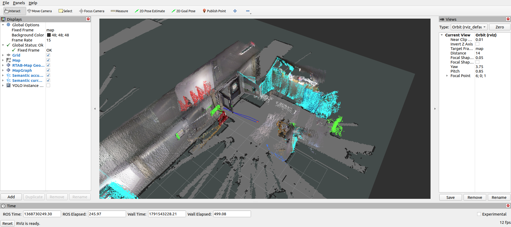
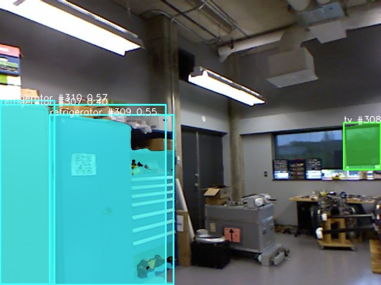

# Semantic SLAM

基于 ROS2 Humble、RTAB-Map 和 YOLOv8n-seg 的松耦合语义建图原型。当前完成官方 Indoor RGB-D + LiDAR rosbag 的回放、实例分割、深度反投影、采集时刻 TF 转换、语义点云累积与 RViz 展示，作为第一阶段复现和后续开发的基线。

语义模块独立运行，不参与 RTAB-Map 的定位、回环检测或后端优化；当前尚未实现紧耦合语义 SLAM。

## 技术方案

```text
rosbag：压缩 RGB、compressedDepth、CameraInfo、LiDAR、里程计与 TF
  └─ RTAB-Map rgbd_sync：解压并同步 RGB-D
       ├─ RTAB-Map + LiDAR + 里程计 TF → 几何地图、位姿图、map → odom
       └─ rgbd_split → RGB / Depth
            └─ YOLOv8n-seg + CameraInfo → 类别 mask、观测实例 mask、标注图
                 └─ 配对深度反投影 → 相机坐标系语义点
                      └─ 深度采集时刻 TF → map 坐标系语义点
                           └─ 5 cm 体素累积与类别投票 → 语义地图
```

默认在 CPU 上运行 YOLO，2 个推理线程、输入尺寸 640、置信度阈值 0.35，每 3 个同步帧处理 1 帧。推理队列最多保留 1 个待处理帧，避免处理延迟持续增长。

检测前以 40 ms 容差配对 RGB、Depth 和 CameraInfo；检测后保留这组深度和内参，以深度时间戳精确同步投影输入。`32FC1` 深度按米使用，`16UC1` 按毫米转换；默认保留 0.3–5 m 深度，横纵方向每 4 个像素采样一次：`X=(u-cx)Z/fx`，`Y=(v-cy)Z/fy`。TF 查询使用采集时间；缺失 TF 时最多等待 5 秒，然后丢弃该帧。

每个体素保存观测坐标均值和类别投票，最多保留 200000 个体素。实例编号用于区分单次观测，并非跨帧对象 ID。

## 环境和依赖

实测环境为 Ubuntu 22.04.5、ROS2 Humble、Python 3.10.12，VMware 虚拟机分配 8 个 CPU，宿主处理器为 Intel Core Ultra 9 275HX。未使用 CUDA。

| 依赖 | 实测版本 |
| --- | --- |
| RTAB-Map / rtabmap_ros | 0.23.13，源码提交见下文 |
| PyTorch / torchvision | 2.5.1+cpu / 0.20.1+cpu |
| Ultralytics | 8.3.221 |
| NumPy / OpenCV Python | 1.26.4 / 4.10.0.84 |
| Pillow / PyYAML | 9.0.1 / 5.4.1 |

ROS 依赖包括 `rclpy`、`cv_bridge`、`message_filters`、`tf2_ros`、`image_transport` 及 compressed/compressedDepth 插件、`rosbag2`、`rviz2`，以及 RTAB-Map 的 demos、sync、util、slam、msgs、rviz_plugins 包。虚拟环境通过 `--system-site-packages` 使用系统 ROS Python 包；NumPy 固定为 1.x，以匹配 Humble 的 cv_bridge。

## 安装与运行

### 准备 ROS 和 RTAB-Map

先按 [ROS2 Humble 官方安装说明](https://docs.ros.org/en/humble/Installation/Ubuntu-Install-Debs.html)安装 Ubuntu 22.04 对应的 ROS 桌面环境。已有本文版本的 RTAB-Map 工作空间可跳过源码构建。

在未安装 RTAB-Map 的环境中，使用与本机相同的上游提交构建；第三方源码放在工作空间 `src/`，本仓库不包含这些源码：

```bash
sudo apt update
sudo apt install -y git curl python3-pip python3-venv python3-rosdep \
  python3-colcon-common-extensions ros-humble-cv-bridge \
  ros-humble-message-filters ros-humble-tf2-ros \
  ros-humble-image-transport ros-humble-compressed-image-transport \
  ros-humble-compressed-depth-image-transport ros-humble-rosbag2 \
  ros-humble-rviz2 x11-utils

source /opt/ros/humble/setup.bash
export RTABMAP_WS="$HOME/ros2"
mkdir -p "$RTABMAP_WS/src"
cd "$RTABMAP_WS"
git clone https://github.com/introlab/rtabmap.git src/rtabmap
git -C src/rtabmap checkout 20b040a77a1c703e126372419737d5645c6db3b2
git clone --branch ros2 https://github.com/introlab/rtabmap_ros.git src/rtabmap_ros
git -C src/rtabmap_ros checkout 5c82ffc2c99e2c445de60a0871aab67704081481
if [ ! -f /etc/ros/rosdep/sources.list.d/20-default.list ]; then
  sudo rosdep init
fi
rosdep update
rosdep install --from-paths src --ignore-src --rosdistro humble -y
export MAKEFLAGS="-j2"
colcon build --symlink-install --executor sequential \
  --cmake-args -DCMAKE_BUILD_TYPE=Release
source "$RTABMAP_WS/install/setup.bash"
```

### 安装语义模块

仓库可克隆到任意目录；`RTABMAP_WS` 默认是 `~/ros2`，工作空间位于其他位置时需设置该环境变量。

```bash
git clone https://github.com/lezebomb/Semantic-SLAM.git ~/Semantic-SLAM
cd ~/Semantic-SLAM
export RTABMAP_WS="$HOME/ros2"
./setup.sh
```

`setup.sh` 检查 ROS 包和官方 `robot_mapping_demo.launch.py`，创建本仓库 `.venv`，安装固定版本 CPU 推理依赖，并从 [Ultralytics 官方资源](https://github.com/ultralytics/assets/releases/download/v8.3.0/yolov8n-seg.pt)下载模型到 `models/yolov8n-seg.pt`。模型 SHA-256 为 `a7cd8f929e1903d78a12a48efecab430209f18dc46cb96c3599a5980c63c423c`，脚本会校验下载结果。模型权重不纳入 Git。

### 获取数据并回放

下载官方 `robot_mapping_demo.launch.py` 指定的 [Indoor RGB-D + LiDAR 数据 demo_mapping.db3](https://drive.google.com/file/d/1v9qJ2U7GlYhqBJr7OQHWbDSCfgiVaLWb/view)，保存为：

```text
~/ros2/data/demo_mapping/demo_mapping_bag/demo_mapping.db3
```

本机验证文件为 332005376 字节，SHA-256 为 `b233777634dea8207677d7a76d76718b43bc7043f03d061f6c332f12a9e07be8`。直接播放 `.db3`，无需依赖 `metadata.yaml` 的版本。

```bash
mkdir -p "$RTABMAP_WS/data/demo_mapping/demo_mapping_bag"
# 将下载的 demo_mapping.db3 放入上面的目录后执行：
cd ~/Semantic-SLAM
./run.sh --rate 0.5 --hold
```

启动器检查数据，启动官方 RTAB-Map launch、语义节点、独立订阅验证器和 RViz，再以 0.5 倍速回放。约 246 秒的数据播放约需 8 分 15 秒；`--hold` 在结束后保留地图和 RViz，按 Ctrl+C 保存并退出。不带 `--hold` 则验证后自动退出。

自定义数据路径、独立 ROS Domain 和无图形回放：

```bash
./run.sh --bag /path/to/demo_mapping.db3 --rate 0.5 --domain-id 91 --no-rviz
./run.sh --rate 0.5 --duration 100 --no-rviz
./run.sh --help
```

`--duration` 是回放墙钟秒数；第二条是短回放检查。还可用 `--rate 0.25` 放慢回放，或通过 `--model /path/to/yolov8n-seg.pt` 指定模型。默认 `ROS_DOMAIN_ID=77`、`ROS_LOCALHOST_ONLY=1`；同一 Domain 内应只运行一套回放和建图节点。

### Topic、TF 与可视化

数据包含 84745 条消息，RGB、Depth、CameraInfo 各 2019 条，时长 245.993887102 秒。相机为 640×480，`fx=fy=525`、`cx=319.5`、`cy=239.5`，畸变参数为零；深度已注册到 RGB 光学坐标系，RGB 与 Depth 采集差约为 ±19 ms。

| 输入 Topic | 格式 / 作用 |
| --- | --- |
| `/data_throttled_image/compressed` | 压缩 RGB，解码为 bgr8 |
| `/data_throttled_image_depth/compressedDepth` | 32FC1 深度，单位米 |
| `/data_throttled_camera_info` | 相机内参 |
| `/jn0/base_scan` | LiDAR LaserScan |
| `/az3/base_controller/odom`、`/tf` | 里程计与 TF |

真实相机 frame 为 `openni_rgb_optical_frame`，经包内机器人 TF 和 `odom` 转入 RTAB-Map 的 `map`；包中没有录制的 `/map`，几何地图由本次运行生成。官方 launch 固定使用上表中的机器人和 Topic，此入口针对该数据集。

RViz 自动加载 `config/semantic_indoor.rviz`，Fixed Frame 为 `map`：`/mapData` 显示 RTAB-Map 几何点云，`/map` 显示栅格地图，`/semantic/map` 显示累计语义点云，`/semantic/pointcloud` 显示当前语义帧。勾选 `YOLO instance segmentation` 可显示 `/semantic/image_annotated`。

类别图 `/semantic/label_image` 为 mono8，0 表示背景，1–80 表示 COCO 类别编号加一；实例图 `/semantic/instance_image` 为 mono16。语义点云包含 `x/y/z`、显示色 `rgb`、`class_id` 和 `instance_id`，RViz 使用 RGB8 着色。累计地图的 QoS 为 Reliable + Transient Local，已在 RViz 配置中匹配。

运行产物保存在仓库 `runs/时间-PID/`，包括独立 `rtabmap.db`、`semantic_map.ply`、`semantic_map.npz`、节点统计、`verification.json` 和日志；这些文件均被 Git 忽略。最近一次运行目录记录在 `artifacts/latest_run.txt`。每次使用新目录，若数据库已存在则拒绝启动，避免清空旧地图。

需要在另一个终端检查 Topic 或手动保存时，保持 Domain 与启动参数一致：

```bash
source /opt/ros/humble/setup.bash
source "${RTABMAP_WS:-$HOME/ros2}/install/setup.bash"
export ROS_DOMAIN_ID=77 ROS_LOCALHOST_ONLY=1
ros2 topic echo /semantic/map_status
ros2 service call /semantic/save_map std_srvs/srv/Trigger '{}'
```

主要文件：`semantic/yolo_detector.py` 负责同步和分割，`semantic/semantic_projector.py` 负责反投影，`semantic/semantic_grid_node.py` 负责 TF 转换和体素累积，`semantic/common.py` 定义点云格式与显示色；`launch/` 连接官方几何建图和语义节点；`scripts/` 提供回放、数据检查、独立订阅验证和 RViz 截图。

## 运行结果

2026-10-09 在独立整理目录中新建 Python 环境、下载模型后，以 0.5 倍速完整复测官方数据，实际播放墙钟 495.58 秒。检测器同步 2018 帧、处理 672 帧、输出 346 次实例检测，未覆盖待处理帧；反投影产生 991789 个语义点，211 帧完成 map 转换，最终保存 110523 个 5 cm 体素。RTAB-Map 数据库含 125 个节点，SQLite `quick_check` 为 `ok`；启动阶段有 1 帧因 TF 不可用被丢弃，推理和投影错误计数均为 0。

该次独立订阅验证检查了非空类别/实例 mask、标注图、map 点云、累积地图及几何 `/map`、`/mapData`，206 次采集时刻 TF 重算的最大坐标分量误差为 `9.54e-7 m`。保存的 NPZ 和 PLY 点数一致，坐标均有限，类别和实例字段有效；`--hold` 与 Ctrl+C 保存已实际验证。

整理版本补充了 ROS 正常关闭异常处理，未改动推理、投影、TF 或体素算法；修复后带 RViz 的 100 秒回放及退出检查通过，Python 节点正常保存退出，无 Traceback。无图形的 100 秒回放也通过。两次短回放退出码均为 0，数据库完整性正常。整包测试中 RViz 的退出报错仍作为已知问题记录。

本次整包 CPU 推理中位数为 128.45 ms、P95 为 211.64 ms；其中约 100 秒与独立 Domain 的短回放检查并行，耗时受到额外 CPU 负载影响。TF 重算误差只验证坐标转换一致性，不代表定位精度；尚未测量 mIoU、mAP 或 ATE。检测次数与体素数量也是模型输出统计，不是分类正确率。ROS 和 RTAB-Map 复用了已安装的工作空间，尚未在另一台干净系统上重新构建验证。

下面两张图片来自该次真实运行。储物柜被模型标为 refrigerator，说明可视化成功并不等于类别正确。





## 当前局限

- COCO 80 类无法覆盖墙、地面和储物柜等室内对象，实测存在 refrigerator、train 等误识别，尚无人工标注评估。
- 实例 ID 是观测编号，会循环使用；未实现跨帧跟踪、三维对象关联或稳定地图对象 ID。
- 回环后已有语义体素不会按优化位姿重新投影，可能产生重复表面或拖影；动态物体也会留下累计轨迹。
- 依赖已注册、同分辨率、同光学 frame 的 RGB-D 与零畸变内参，不能直接接入未经配准的其他相机；本入口的几何 launch 也固定匹配官方数据。
- 重复回放记录中出现过旧 TF 数据及约 0.10 m 的独立重算差异。验证器会将这类运行判为失败；运行时应隔离 ROS Domain，后续仍需排查时间戳和 TF 更新时序。
- 本机 VMware/Mesa 下 RViz 栅格显示曾有 shader 警告；仿真时钟停止后 RViz 退出曾需要强制清理，本次整包退出也出现 `std::system_error`。几何和语义结果可通过无图形回放独立检查，启动器在 `result.json` 单独记录 RViz 关闭错误。

RTAB-Map 的官方 launch 通过包依赖调用，RViz 配置基于其演示配置调整，保留的版权及 BSD 条款见 [licenses/rtabmap_ros-BSD.txt](licenses/rtabmap_ros-BSD.txt)。设计流程参考 [rtabmap_allinone](https://github.com/nasyihulwan/rtabmap_allinone/tree/d7d4d8318a1c21db211b260f534d1af73736120c)，本仓库不发布其参考源码。项目使用 [Ultralytics 8.3.221](https://github.com/ultralytics/ultralytics/tree/v8.3.221) 的分割 API 和官方模型，采用 [AGPL-3.0](LICENSE) 发布。
